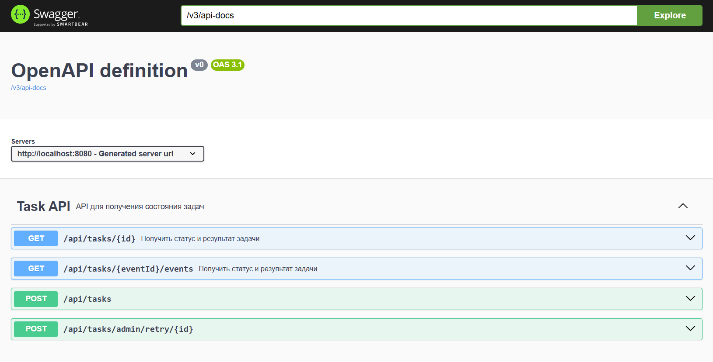

# Tech Stack

| Technology      | Version |
|-----------------|---------|
| Java            | 21      |
| Spring Boot     | 3.5     |
| PostgreSQL      | 17      |
| Spring Data JPA |   |
| Flyway          |   |
| Docker          |   |
| Maven           |     |
| JUnit 5         |   |
| Testcontainers  |   |

- I used for concurrency processing 
- FOR UPDATE SKIP LOCKED approach.
- Added all new fields as suggested with new flyway changes.
- Used eventId as User/Client side idempotency key.
- For convenience added task publisher.
- Added database indexes.
